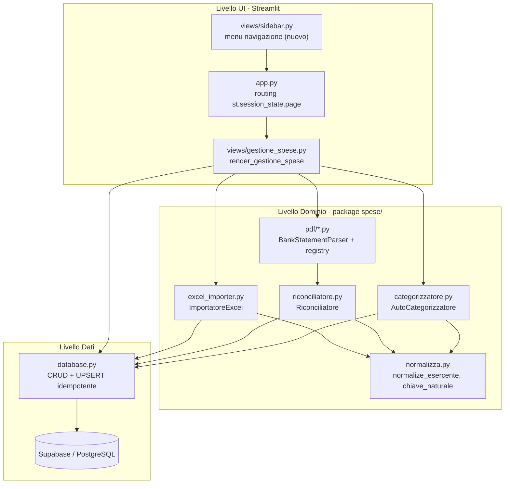
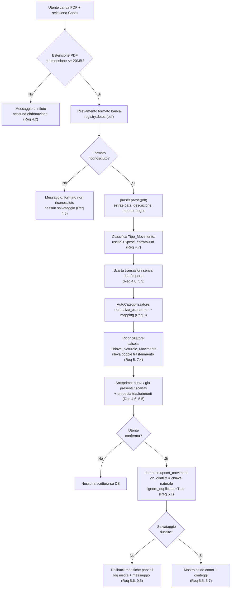

# Design Document

## Overview

La sezione **Gestione Spese** aggiunge all'app Streamlit esistente un'area funzionale autonoma per registrare, importare, categorizzare, visualizzare e correggere spese ed entrate personali su più conti. L'area è indipendente dal tracking investimenti ma riusa gli stessi pattern architetturali del progetto:

- **Routing** basato su `st.session_state.page` in `app.py`, con una funzione `render_*` dedicata in `views/`.
- **Accesso dati centralizzato** in `database.py`, con client Supabase creato via `get_secret` e **UPSERT idempotente** su chiavi naturali.
- **Migrazioni SQL timestamp-prefixed** in `supabase/migrations/` secondo le convenzioni già osservate (`create table if not exists`, `id bigint generated always as identity`, `created_at`/`updated_at`, `comment on table`, `create index if not exists`).

Il design introduce tre capacità principali e un abilitatore trasversale:

1. **Modello dati Supabase** per conti, categorie, sotto-categorie, movimenti e mapping esercente→categoria (Requirement 2, 9).
2. **Import storico Excel** (Requirement 3) e **import estratti conto PDF multi-banca** con riconciliazione/deduplicazione (Requirement 4, 5).
3. **Auto-categorizzazione per esercente** con normalizzazione deterministica e mapping persistito e correggibile (Requirement 6).
4. **Abilitatore di navigazione**: introduzione di un menu reale nella sidebar (oggi assente) senza rompere le pagine esistenti (Requirement 1), e gestione dei trasferimenti come coppia speculare esclusa dai totali (Requirement 7), oltre a UI di visualizzazione/filtro/modifica (Requirement 8).

### Decisioni di design chiave e motivazioni

- **Normalizzazione esercente deterministica unica**: la stessa funzione `normalize_esercente` viene usata sia in scrittura sia in lettura del mapping (Req 6.8) e per calcolare la `descrizione_normalizzata` della Chiave_Naturale_Movimento (Req 5). Si riusa `unidecode` (già in `requirements.txt`) coerentemente con `clean_col_name` in `utils.py`.
- **Idempotenza tramite UPSERT su chiave naturale**: si replica il pattern reale di `insert_directa_transaction`/`insert_bond_coupons` (`on_conflict` su colonne naturali, `ignore_duplicates=True` per gli import). Questo soddisfa direttamente Req 3.7/3.8 e 5.1/5.2/5.4 senza logica di dedup lato applicazione.
- **Parsing PDF dietro strategy per banca**: nessuna libreria PDF è presente oggi. Si propone l'aggiunta di `pdfplumber` (vedi sotto) e si isola l'estrazione dietro un'interfaccia `BankStatementParser` con un registry, così da aggiungere banche future senza toccare il resto del sistema (Req 4.4, estensibilità).
- **Sidebar con navigazione reale ma retrocompatibile**: si aggiunge un `st.radio` (o gruppo di bottoni) che imposta `st.session_state.page`, mantenendo i contenuti informativi attuali sotto il menu. I valori di routing esistenti non cambiano; si aggiunge solo la voce `gestione_spese`.

### Nuova dipendenza proposta

Aggiungere a `requirements.txt`:

```
pdfplumber
```

**Motivazione**: `pdfplumber` estrae testo e tabelle con posizione dalle pagine PDF, adatto agli estratti conto bancari (layout tabellari eterogenei) ed è puro Python (nessun binario esterno rispetto ad alternative come `camelot`). Resta isolato dietro l'interfaccia parser: se in futuro una banca richiedesse OCR o un'altra libreria, si aggiunge una strategy senza impattare il core. La dipendenza va pinnata/gestita coerentemente con la policy del progetto al momento dell'installazione.

## Architecture

La sezione è un sottosistema a tre livelli sopra `database.py`:

- **Livello UI** (`views/gestione_spese.py`): orchestrazione Streamlit, upload, anteprime, filtri, editing inline, messaggi utente.
- **Livello logica di dominio** (nuovo package `spese/`): funzioni pure e componenti (normalizzazione, chiave naturale, auto-categorizzazione, riconciliazione, parser PDF, importatore Excel). Qui vive la logica testabile e indipendente da Streamlit/Supabase.
- **Livello dati** (`database.py`): nuove funzioni CRUD/UPSERT per movimenti, conti, categorie, sotto-categorie e mapping, coerenti con lo stile esistente.



### Flusso di import PDF → parsing → auto-categorizzazione → riconciliazione → salvataggio



### Integrazione col routing esistente

1. **`app.py`**: aggiungere l'import `from views.gestione_spese import render_gestione_spese` e un ramo nella catena di routing:

```python
elif st.session_state.page == "gestione_spese":
    render_gestione_spese()
```

2. **`views/sidebar.py`**: introdurre un menu di navigazione reale. Oggi la sidebar mostra solo testo-guida; si aggiunge in cima un selettore che imposta `st.session_state.page`, mantenendo sotto la guida attuale. Esempio di approccio con mapping etichetta→chiave di pagina:

```python
PAGINE = {
    "📊 Dashboard": "dashboard",
    "💼 Gestione ETF": "gestione_etf",
    "📈 Metriche": "metriche",
    "📅 Rendimento Annuo": "rendimento_annuo",
    "🧮 Simula ETF": "simula_etf",
    "🎯 Prossimo PAC": "prossimo_pac",
    "🔮 Proiezioni Future": "proiezioni_future",
    "⚙️ Impostazioni": "impostazioni",
    "💶 Gestione Spese": "gestione_spese",   # nuova voce (Req 1.1)
}
```

Il selettore sincronizza l'indice corrente con `st.session_state.page`; la selezione utente aggiorna `st.session_state.page` e forza `st.rerun()`. Le pagine esistenti restano raggiungibili con le stesse stringhe di routing, quindi nessuna rottura (Req 1.2, 1.3). Il default resta `"dashboard"` perché inizializzato in `main()` (Req 1.4).

3. **Isolamento errori di rendering**: `render_gestione_spese` incapsula il corpo in `try/except`; in caso di eccezione mostra `st.error(...)` e non modifica `st.session_state.page`, preservando la navigazione (Req 1.6).

## Components and Interfaces

### 1. UI — `views/gestione_spese.py`

```python
def render_gestione_spese() -> None:
    """Punto di ingresso della sezione. Orchestrazione a tab:
    - Tab "Movimenti": elenco + filtri + editing/eliminazione inline (Req 8)
    - Tab "Import Excel": upload storico .xlsx (Req 3)
    - Tab "Import Estratto Conto": upload PDF + selezione conto + anteprima (Req 4,5)
    - Tab "Trasferimenti": registrazione/riclassificazione coppie (Req 7)
    - Tab "Saldi": saldo per conto (Req 5.7)
    L'intero corpo e' protetto da try/except per non rompere la navigazione (Req 1.6)."""
```

### 2. Normalizzazione e chiave naturale — `spese/normalizza.py`

```python
def normalize_esercente(descrizione: str) -> str:
    """Regola DETERMINISTICA di normalizzazione dell'esercente.
    Passi: unidecode -> lowercasing -> strip -> collasso spazi multipli ->
    rimozione token di rumore noti (es. 'pos ', 'pagamento ', 'carta ', date,
    numeri di autorizzazione, citta'/stato finali). Usa la stessa logica di
    clean_col_name di utils.py per coerenza.
    Usata identica in scrittura e lettura del mapping (Req 6.8)."""

def chiave_naturale_movimento(data_iso: str, conto: str, importo_eur: float,
                              descrizione: str) -> tuple[str, str, float, str] | None:
    """Calcola la Chiave_Naturale_Movimento = (data, conto, importo_eur,
    descrizione_normalizzata). Ritorna None se un componente obbligatorio
    manca o non e' calcolabile (Req 5.3). importo_eur arrotondato a 2 decimali.
    descrizione_normalizzata = normalize_esercente(descrizione)."""
```

### 3. Importatore Excel — `spese/excel_importer.py`

```python
COLONNE_ATTESE = ["Periodo", "Conto", "Categoria", "Sotto-categoria",
                  "Nota", "EUR", "Guadagni/Spese", "Descrizione", "Valuta"]

def leggi_storico_excel(file) -> tuple[list[dict], list[str]]:
    """Legge .xlsx con openpyxl/pandas. Ritorna (righe_mappate, colonne_mancanti).
    Se il file non e' un .xlsx valido solleva un errore gestito dalla UI (Req 3.2).
    Se mancano colonne attese, ritorna colonne_mancanti non vuoto (Req 3.3)."""

def mappa_riga_a_movimento(riga: dict) -> dict | None:
    """Mappa le colonne storiche sui campi Movimento. Converte 'Guadagni/Spese'
    nel Tipo_Movimento. Ritorna None se mancano campi obbligatori (Req 3.4)."""

def importa_storico(file) -> dict:
    """Orchestration: legge, crea conti/categorie/sotto-categorie mancanti
    (Req 3.5, 3.6), esegue upsert idempotente (Req 3.7, 3.8) e ritorna un
    riepilogo {importati, ignorati_presenti, scartati} (Req 3.9)."""
```

### 4. Parser PDF multi-banca — package `spese/pdf/`

```python
# spese/pdf/base.py
class BankStatementParser(Protocol):
    nome_banca: str
    def riconosce(self, testo_pdf: str) -> bool:
        """True se il layout/intestazione del PDF corrisponde a questa banca (Req 4.4)."""
    def estrai_movimenti(self, pdf) -> list["TransazioneEstratta"]:
        """Estrae data, descrizione, importo (2 decimali) e segno per ogni riga (Req 4.3).
        Esclude e annota transazioni senza data/importo (Req 4.8)."""

# spese/pdf/registry.py
def registra_parser(parser: BankStatementParser) -> None: ...
def rileva_parser(testo_pdf: str) -> BankStatementParser | None:
    """Scorre i parser registrati e ritorna il primo che riconosce il formato,
    altrimenti None (Req 4.5)."""

# spese/pdf/revolut.py, bbva.py, ... : implementazioni concrete per banca
```

`TransazioneEstratta`: dataclass con `data: date | None`, `descrizione: str`, `importo_eur: float | None`, `segno: Literal["entrata","uscita"]`, `motivo_esclusione: str | None`.

### 5. Auto-categorizzatore — `spese/categorizzatore.py`

```python
def categorizza(movimento: dict, mapping: dict[str, dict]) -> dict:
    """Assegna Categoria/Sotto_Categoria al movimento se normalize_esercente
    (descrizione) e' presente in mapping (Req 6.2, 6.3). Altrimenti lascia
    categoria None e flag da_categorizzare=True (Req 6.4). Funzione pura: non
    scrive su DB."""

def aggiorna_mapping_da_correzione(esercente_norm: str, categoria: str,
                                   sotto_categoria: str | None) -> dict:
    """Costruisce il record di mapping da persistere via upsert quando l'utente
    crea/corregge una categoria (Req 6.5, 6.6)."""
```

### 6. Riconciliatore — `spese/riconciliatore.py`

```python
def prepara_per_upsert(transazioni: list[dict], conto: str) -> dict:
    """Calcola la chiave naturale per ogni transazione; separa in
    {validi, scartati} (chiave non calcolabile -> scartato, Req 5.3).
    Ritorna conteggi e record pronti per l'upsert."""

def rileva_coppie_trasferimento(movimenti: list[dict]) -> list[tuple[dict, dict]]:
    """Individua coppie (uscita conto A, entrata conto B!=A) con differenza
    importo = 0 e differenza data = 0 giorni (Req 7.4). Ritorna le coppie da
    proporre all'utente per la riclassificazione come Trasferimento."""

def saldo_conto(movimenti_conto: list[dict]) -> float:
    """Somma algebrica dei movimenti del conto per il saldo (Req 5.7)."""
```

### 7. Layer dati — nuove funzioni in `database.py`

Firme coerenti con lo stile esistente (ritorno `response`/`list`/`None`, `try/except` con `logging.error`, upsert con `on_conflict`). `get_secret` e il client `supabase` già presenti vengono riusati (Req 9.2, 9.3).

```python
# Conti
def get_conti() -> list[dict]: ...
def upsert_conto(nome: str) -> dict | None:            # on_conflict="nome", ignore_duplicates=True
def get_or_create_conto(nome: str) -> int | None: ...   # ritorna id

# Categorie / Sotto-categorie
def get_categorie() -> list[dict]: ...
def upsert_categoria(nome: str) -> dict | None:        # on_conflict="nome"
def get_sotto_categorie() -> list[dict]: ...
def upsert_sotto_categoria(nome: str, categoria_id: int) -> dict | None:  # on_conflict="categoria_id, nome"

# Movimenti
def get_movimenti(conto: str | None = None, categoria: str | None = None,
                  data_da: str | None = None, data_a: str | None = None) -> list[dict]:
    """SELECT con filtri opzionali, ordinato per data desc, paginazione .range()
    a pagine di 1000 come get_etf_history (Req 8.1, 8.3-8.5)."""
def upsert_movimenti(movimenti: list[dict]) -> object | None:
    """UPSERT idempotente su on_conflict='data_movimento, conto_id, importo_eur,
    descrizione_normalizzata', ignore_duplicates=True. Sanitizza i record con
    make_json_serializable (Timestamp->isoformat, NaN->None) (Req 3.7, 5.1)."""
def update_movimento(movimento_id: int, campi: dict) -> object | None:  # Req 8.8
def delete_movimento(movimento_id: int) -> object | None:               # Req 8.10
def insert_trasferimento(conto_origine_id: int, conto_dest_id: int,
                         importo_eur: float, data_iso: str,
                         nota: str | None = None) -> object | None:
    """Inserisce i due movimenti speculari in modo atomico; se uno fallisce,
    rimuove l'altro (compensazione) (Req 7.1, 7.2)."""

# Mapping esercente -> categoria
def get_mapping_esercente() -> list[dict]: ...
def upsert_mapping_esercente(esercente_norm: str, categoria_id: int,
                             sotto_categoria_id: int | None) -> object | None:
    """on_conflict='esercente_normalizzato', ignore_duplicates=False
    (aggiorna in caso di correzione) (Req 6.5, 6.6)."""
```

## Data Models

Cinque tabelle nuove su Supabase (PostgreSQL). Le convenzioni seguono le migrazioni esistenti (`bigint generated always as identity`, `created_at`/`updated_at`, `comment on table`, indici `idx_...`).

### Tabella `conti`
| Colonna | Tipo | Vincoli |
|---|---|---|
| id | bigint identity | PK |
| nome | varchar | NOT NULL, UNIQUE (`conti_nome_key`), CHECK lunghezza > 0 |
| created_at / updated_at | timestamp | default now() |

### Tabella `categorie`
| Colonna | Tipo | Vincoli |
|---|---|---|
| id | bigint identity | PK |
| nome | varchar | NOT NULL, UNIQUE (`categorie_nome_key`), CHECK lunghezza > 0 |
| created_at / updated_at | timestamp | default now() |

### Tabella `sotto_categorie`
| Colonna | Tipo | Vincoli |
|---|---|---|
| id | bigint identity | PK |
| categoria_id | bigint | NOT NULL, FK → `categorie(id)` |
| nome | varchar | NOT NULL, CHECK lunghezza > 0 |
| | | UNIQUE (`sotto_categorie_cat_nome_key`) su (categoria_id, nome) |

Ogni sotto-categoria appartiene a esattamente una categoria esistente (Req 2.4).

### Tabella `movimenti`
| Colonna | Tipo | Vincoli |
|---|---|---|
| id | bigint identity | PK |
| data_movimento | date | NOT NULL (Req 2.1, 2.8) |
| conto_id | bigint | NOT NULL, FK → `conti(id)` (Req 2.7) |
| importo_eur | numeric | NOT NULL |
| tipo_movimento | varchar | NOT NULL, CHECK in set del Glossary (Req 2.5, 2.6) |
| valuta | varchar | NOT NULL, default `'EUR'` (Req 2.9) |
| categoria_id | bigint | NULL, FK → `categorie(id)` (Req 2.1, 2.11) |
| sotto_categoria_id | bigint | NULL, FK → `sotto_categorie(id)` |
| nota | varchar | NULL |
| descrizione | varchar | NULL |
| descrizione_normalizzata | varchar | NOT NULL (componente chiave naturale) |
| created_at / updated_at | timestamp | default now() |

**Chiave_Naturale_Movimento** → UNIQUE `movimenti_chiave_naturale_key` su (`data_movimento, conto_id, importo_eur, descrizione_normalizzata`). È la base dell'UPSERT idempotente (Req 3.7, 3.8, 5.1, 5.2, 5.4).

Il CHECK su `tipo_movimento` ammette esattamente: `'Spese'`, `'In'`, `'Trasferimento ingresso'`, `'Trasferimento uscita'`, `'Aumento Saldo'`, `'Decremento Saldo'`.

### Tabella `mapping_esercente_categoria`
| Colonna | Tipo | Vincoli |
|---|---|---|
| id | bigint identity | PK |
| esercente_normalizzato | varchar | NOT NULL, UNIQUE (`mapping_esercente_key`) (Req 6.1) |
| categoria_id | bigint | NOT NULL, FK → `categorie(id)` |
| sotto_categoria_id | bigint | NULL, FK → `sotto_categorie(id)` |
| created_at / updated_at | timestamp | default now() |

A ogni esercente normalizzato corrisponde al più una voce (Req 6.1).

```mermaid
erDiagram
    conti ||--o{ movimenti : "conto_id"
    categorie ||--o{ sotto_categorie : "categoria_id"
    categorie ||--o{ movimenti : "categoria_id"
    sotto_categorie ||--o{ movimenti : "sotto_categoria_id"
    categorie ||--o{ mapping_esercente_categoria : "categoria_id"
    sotto_categorie ||--o{ mapping_esercente_categoria : "sotto_categoria_id"

    conti { bigint id PK; varchar nome UK }
    categorie { bigint id PK; varchar nome UK }
    sotto_categorie { bigint id PK; bigint categoria_id FK; varchar nome }
    movimenti {
        bigint id PK
        date data_movimento
        bigint conto_id FK
        numeric importo_eur
        varchar tipo_movimento
        varchar valuta
        bigint categoria_id FK
        bigint sotto_categoria_id FK
        varchar descrizione_normalizzata
    }
    mapping_esercente_categoria {
        bigint id PK
        varchar esercente_normalizzato UK
        bigint categoria_id FK
        bigint sotto_categoria_id FK
    }
```

### Scheletro migrazioni SQL (timestamp-prefixed)

I file seguono `YYYYMMDDHHMMSS_descrizione.sql` in `supabase/migrations/`. Ordine: tabelle referenziate prima delle referenzianti.

`<ts1>_create_conti_table.sql`
```sql
create table if not exists public.conti (
  id bigint generated always as identity primary key,
  nome varchar not null,
  created_at timestamp without time zone default now(),
  updated_at timestamp without time zone default now(),
  constraint conti_nome_key unique (nome),
  constraint conti_nome_non_vuoto check (length(trim(nome)) > 0)
);
comment on table public.conti is 'Conti finanziari dell''utente per la gestione spese.';
create index if not exists idx_conti_nome on public.conti (nome);
```

`<ts2>_create_categorie_table.sql`
```sql
create table if not exists public.categorie (
  id bigint generated always as identity primary key,
  nome varchar not null,
  created_at timestamp without time zone default now(),
  updated_at timestamp without time zone default now(),
  constraint categorie_nome_key unique (nome),
  constraint categorie_nome_non_vuoto check (length(trim(nome)) > 0)
);
comment on table public.categorie is 'Categorie di classificazione dei movimenti di spesa.';
```

`<ts3>_create_sotto_categorie_table.sql`
```sql
create table if not exists public.sotto_categorie (
  id bigint generated always as identity primary key,
  categoria_id bigint not null references public.categorie (id),
  nome varchar not null,
  created_at timestamp without time zone default now(),
  updated_at timestamp without time zone default now(),
  constraint sotto_categorie_cat_nome_key unique (categoria_id, nome),
  constraint sotto_categorie_nome_non_vuoto check (length(trim(nome)) > 0)
);
comment on table public.sotto_categorie is 'Sotto-categorie, ciascuna legata a una sola categoria.';
create index if not exists idx_sotto_categorie_categoria on public.sotto_categorie (categoria_id);
```

`<ts4>_create_movimenti_table.sql`
```sql
create table if not exists public.movimenti (
  id bigint generated always as identity primary key,
  data_movimento date not null,
  conto_id bigint not null references public.conti (id),
  importo_eur numeric not null,
  tipo_movimento varchar not null,
  valuta varchar not null default 'EUR',
  categoria_id bigint references public.categorie (id),
  sotto_categoria_id bigint references public.sotto_categorie (id),
  nota varchar,
  descrizione varchar,
  descrizione_normalizzata varchar not null,
  created_at timestamp without time zone default now(),
  updated_at timestamp without time zone default now(),
  constraint movimenti_tipo_movimento_check check (
    tipo_movimento in (
      'Spese', 'In', 'Trasferimento ingresso',
      'Trasferimento uscita', 'Aumento Saldo', 'Decremento Saldo'
    )
  ),
  constraint movimenti_chiave_naturale_key unique (
    data_movimento, conto_id, importo_eur, descrizione_normalizzata
  )
);
comment on table public.movimenti is 'Movimenti di spesa/entrata. Chiave naturale per upsert idempotente: data + conto + importo_eur + descrizione_normalizzata.';
create index if not exists idx_movimenti_data on public.movimenti (data_movimento);
create index if not exists idx_movimenti_conto on public.movimenti (conto_id);
create index if not exists idx_movimenti_categoria on public.movimenti (categoria_id);
```

`<ts5>_create_mapping_esercente_categoria_table.sql`
```sql
create table if not exists public.mapping_esercente_categoria (
  id bigint generated always as identity primary key,
  esercente_normalizzato varchar not null,
  categoria_id bigint not null references public.categorie (id),
  sotto_categoria_id bigint references public.sotto_categorie (id),
  created_at timestamp without time zone default now(),
  updated_at timestamp without time zone default now(),
  constraint mapping_esercente_key unique (esercente_normalizzato)
);
comment on table public.mapping_esercente_categoria is 'Mapping esercente normalizzato -> categoria/sotto-categoria di default per auto-categorizzazione.';
create index if not exists idx_mapping_esercente on public.mapping_esercente_categoria (esercente_normalizzato);
```

## Flussi UI della pagina Gestione Spese

La pagina è organizzata a tab per isolare i flussi (ciascuno con messaggi utente e nessun crash):

- **Movimenti** (Req 8): elenco ordinato per data desc con data, conto, categoria, sotto-categoria, descrizione, nota, importo. Filtri per conto (8.3), categoria (8.4), intervallo date estremi inclusi (8.5); se data iniziale > finale, errore e elenco invariato (8.7). Messaggi dedicati per "nessun movimento" (8.2) e "nessun risultato" (8.6). Editing inline via `st.data_editor`/form: la conferma con valori validi aggiorna il DB e mostra conferma (8.8); importo non numerico o data non valida → rifiuto e messaggio, movimento invariato (8.9). Eliminazione con conferma (8.10). La modifica della categoria dall'elenco applica l'aggiornamento del mapping (8.11 → Req 6.5/6.6).
- **Import Excel** (Req 3): `st.file_uploader(type=["xlsx"])`, validazione colonne, riepilogo importati/ignorati/scartati.
- **Import Estratto Conto** (Req 4, 5): `st.file_uploader(type=["pdf"])` con limite 20 MB (4.1/4.2), `st.selectbox` del conto, rilevamento formato, anteprima con conteggi e transazioni escluse (4.6/4.8), proposta coppie trasferimento (7.4), conferma → upsert idempotente, poi saldo e conteggi (5.5/5.7).
- **Trasferimenti** (Req 7): form per registrare un trasferimento (validazione conto origine ≠ destinazione e importo > 0, 7.3), riclassificazione di una coppia proposta, inserimento del lato speculare mancante (7.6).
- **Saldi** (Req 5.7): saldo per conto come somma algebrica dei movimenti.

**Esclusione trasferimenti dai totali** (Req 7.5): tutte le aggregazioni di spesa/entrata filtrano via i movimenti con `tipo_movimento` in (`'Trasferimento ingresso'`, `'Trasferimento uscita'`). Questo filtro è centralizzato in una helper di dominio per garantire coerenza in ogni visualizzazione.

## Error Handling

Si segue il pattern reale del progetto: `try/except` con `logging.error`, ritorno di valore neutro (`[]`/`None`) e messaggio utente, senza interrompere l'app.

- **Rendering pagina** (Req 1.6): `render_gestione_spese` incapsula il corpo in `try/except`; su eccezione mostra `st.error` e lascia invariato `st.session_state.page`.
- **Lettura/scrittura DB** (Req 9.5): ogni funzione di `database.py` logga l'errore e ritorna neutro; la UI mostra un messaggio e non applica modifiche parziali. Le operazioni in batch usano UPSERT atomico lato Supabase; per il trasferimento, se il secondo movimento fallisce si rimuove il primo (compensazione) e si notifica l'errore (Req 7.2).
- **Import Excel** (Req 3.2, 3.3, 3.4): file non valido → stop senza salvataggi; colonne mancanti → messaggio con l'elenco; righe senza campi obbligatori → scartate e conteggiate.
- **Import PDF** (Req 4.2, 4.5, 4.8): rifiuto file per estensione/dimensione; formato non riconosciuto → nessun salvataggio; transazioni senza data/importo → escluse e segnalate con motivo.
- **Riconciliazione** (Req 5.3, 5.6): chiave naturale non calcolabile → scartata; fallimento salvataggio → rollback delle modifiche parziali e stato precedente preservato.
- **Validazione input UI** (Req 8.7, 8.9): intervallo date invertito e campi non validi vengono rifiutati con messaggio, senza toccare i dati.

Timeout/irraggiungibilità DB oltre la soglia (Req 9.5): le chiamate restano protette da `try/except`; in assenza di risposta si logga e si mostra errore, preservando i dati inseriti dall'utente.

## Correctness Properties

*Una proprietà è una caratteristica o un comportamento che deve risultare vero in tutte le esecuzioni valide di un sistema: in sostanza un'affermazione formale su ciò che il sistema deve fare. Le proprietà fungono da ponte tra specifiche leggibili dall'uomo e garanzie di correttezza verificabili dalla macchina.*

Le proprietà seguenti derivano dalla prework di analisi delle acceptance criteria, dopo la riflessione di consolidamento delle ridondanze. Riguardano la logica pura del package `spese/` (normalizzazione, chiave naturale, dedup, categorizzazione, parsing, filtri, aggregazioni), isolata da Streamlit e Supabase.

### Property 1: Normalizzazione esercente deterministica e idempotente

*Per ogni* descrizione di transazione, `normalize_esercente` è deterministica (ripetute invocazioni sullo stesso input producono lo stesso output) e idempotente (`normalize_esercente(normalize_esercente(x)) == normalize_esercente(x)`), così da garantire lo stesso esercente normalizzato in scrittura e in lettura del mapping.

**Validates: Requirements 6.8**

### Property 2: Dedup idempotente sulla Chiave_Naturale_Movimento

*Per ogni* insieme di movimenti, applicare la deduplicazione sulla Chiave_Naturale_Movimento è idempotente: ripetere il salvataggio degli stessi movimenti non altera l'insieme risultante (la cardinalità resta invariata), i movimenti con chiave naturale già presente conservano i valori esistenti, e l'unione di un insieme con un suo sovra-insieme sovrapposto non crea duplicati.

**Validates: Requirements 3.7, 3.8, 5.1, 5.2, 5.4**

### Property 3: Chiave naturale non calcolabile implica scarto

*Per ogni* movimento privo di un componente obbligatorio della chiave (data, conto, importo o descrizione), `chiave_naturale_movimento` restituisce `None` e il movimento viene conteggiato tra gli scartati.

**Validates: Requirements 5.3**

### Property 4: Conservazione dei conteggi di import/riconciliazione

*Per ogni* insieme di righe/movimenti in ingresso, la somma dei conteggi (importati/nuovi) + (ignorati perché già presenti) + (scartati perché non validi) è uguale al numero totale di righe in ingresso, con valore 0 per ogni categoria priva di elementi.

**Validates: Requirements 3.9, 5.5**

### Property 5: Mappatura deterministica delle colonne storiche Excel

*Per ogni* riga valida dello storico Excel, `mappa_riga_a_movimento` produce un movimento i cui campi (data, conto, categoria, sotto-categoria, nota, importo in EUR, tipo movimento, descrizione, valuta) corrispondono esattamente al mapping definito tra colonne storiche e campi del Movimento.

**Validates: Requirements 3.1**

### Property 6: Rilevamento delle colonne mancanti

*Per ogni* sottoinsieme di colonne attese rimosso dal file, l'insieme di colonne segnalate come mancanti dall'Importatore_Excel è esattamente uguale all'insieme delle colonne rimosse.

**Validates: Requirements 3.3**

### Property 7: Validazione dell'upload PDF

*Per ogni* file caratterizzato da (estensione, dimensione), l'upload è accettato se e solo se l'estensione è PDF e la dimensione è minore o uguale a 20 MB; in ogni altro caso è rifiutato con motivo e senza avviare l'elaborazione.

**Validates: Requirements 4.1, 4.2**

### Property 8: Round-trip del parser PDF per banca

*Per ogni* transazione generata e *per ogni* banca supportata, formattando la transazione nel layout testuale di quella banca e ri-parsandola con il relativo `BankStatementParser` si ottengono gli stessi valori di data, descrizione, importo (2 decimali) e segno.

**Validates: Requirements 4.3**

### Property 9: Rilevamento del formato banca

*Per ogni* estratto conto sintetico prodotto nel formato di una banca supportata, `rileva_parser` restituisce il parser di quella specifica banca.

**Validates: Requirements 4.4**

### Property 10: Mappatura segno → tipo movimento

*Per ogni* transazione estratta, il segno "uscita" è mappato a Tipo_Movimento "Spese" e il segno "entrata" a Tipo_Movimento "In" (salvo successiva riclassificazione come Trasferimento).

**Validates: Requirements 4.7**

### Property 11: Validazione del valore di Tipo_Movimento

*Per ogni* stringa, la validazione del Tipo_Movimento accetta il salvataggio se e solo se la stringa appartiene all'insieme definito nel Glossary; ogni valore non appartenente viene rifiutato senza modificare i dati esistenti.

**Validates: Requirements 2.5, 2.6**

### Property 12: Auto-categorizzazione da mapping corrente

*Per ogni* movimento il cui esercente normalizzato è presente nel Mapping_Esercente_Categoria fornito, `categorizza` assegna la Categoria di default della voce e, quando la voce ha una Sotto_Categoria di default, assegna anche quella; poiché la funzione usa il mapping corrente passato in input, riflette sempre l'ultima correzione manuale.

**Validates: Requirements 6.2, 6.3, 6.7**

### Property 13: Esercente non mappato resta da categorizzare

*Per ogni* movimento il cui esercente normalizzato non è presente nel mapping, `categorizza` lascia la Categoria non assegnata (`None`) e contrassegna il movimento come da categorizzare.

**Validates: Requirements 6.4**

### Property 14: Coppia di trasferimento speculare

*Per ogni* trasferimento valido (conti distinti, importo > 0, data), la costruzione produce due movimenti con pari importo e pari data: uno con Tipo_Movimento "Trasferimento uscita" sul conto di origine e uno con "Trasferimento ingresso" sul conto di destinazione.

**Validates: Requirements 7.1**

### Property 15: Validazione della registrazione di un trasferimento

*Per ogni* terna (conto di origine, conto di destinazione, importo), la registrazione del trasferimento è ammessa se e solo se i due conti sono distinti e l'importo è maggiore di 0; in ogni altro caso è rifiutata senza creare alcun movimento.

**Validates: Requirements 7.3**

### Property 16: Rilevamento delle coppie di trasferimento

*Per ogni* insieme di movimenti, `rileva_coppie_trasferimento` restituisce esattamente le coppie costituite da un'uscita su un conto e un'entrata su un conto diverso con differenza di importo pari a 0 e differenza di data pari a 0 giorni, e nessuna coppia che non soddisfi tali criteri.

**Validates: Requirements 7.4**

### Property 17: Esclusione dei trasferimenti dai totali

*Per ogni* insieme di movimenti, i totali di spesa e di entrata escludono tutti i movimenti con Tipo_Movimento "Trasferimento ingresso" o "Trasferimento uscita".

**Validates: Requirements 7.5**

### Property 18: Saldo del conto uguale alla somma dei movimenti

*Per ogni* lista di movimenti di un conto, `saldo_conto` è uguale alla somma algebrica (con segno) degli importi dei movimenti di quel conto.

**Validates: Requirements 5.7**

### Property 19: Ordinamento dell'elenco per data decrescente

*Per ogni* lista di movimenti, l'elenco prodotto per la visualizzazione è ordinato per data in ordine non crescente.

**Validates: Requirements 8.1**

### Property 20: Correttezza dei filtri dell'elenco

*Per ogni* lista di movimenti e *per ogni* combinazione di filtri (conto, categoria, intervallo di date con estremi inclusi), l'insieme filtrato contiene esattamente i movimenti che soddisfano tutti i filtri attivi: nessun movimento conforme viene omesso e nessun movimento non conforme viene incluso.

**Validates: Requirements 8.3, 8.4, 8.5**

## Testing Strategy

Si adotta un approccio di test duale: test property-based per le proprietà universali della logica pura e test basati su esempi/edge-case/integrazione per il resto. La logica di dominio del package `spese/` è progettata pura (nessuna dipendenza da Streamlit/Supabase) proprio per renderla testabile in isolamento.

### Property-based testing

- **Libreria**: `hypothesis` (standard de-facto per Python). Da aggiungere come dipendenza di sviluppo. Non si implementa PBT da zero.
- **Iterazioni**: ogni test property configurato con minimo 100 iterazioni (`@settings(max_examples=100)`).
- **Tag**: ogni test property riporta in un commento il riferimento alla proprietà di design, nel formato:
  `# Feature: gestione-spese, Property {numero}: {testo proprietà}`
- **Copertura**: una singola property-based test implementa ciascuna delle 20 proprietà della sezione Correctness Properties. Le proprietà di parsing (8) usano generatori di transazioni e un formatter sintetico per banca per il round-trip. Le proprietà su dedup/upsert (2) testano la funzione pura di deduplicazione su chiave naturale con `supabase` sostituito da mock, non l'I/O reale.

Proprietà e generatori principali:
- Normalizzazione (P1): generatori di stringhe arbitrarie incl. accenti, maiuscole, rumore.
- Dedup idempotente (P2), conservazione conteggi (P4): generatori di liste di movimenti con chiavi ripetute e sovrapposte.
- Parser round-trip (P8) e rilevamento banca (P9): generatori di transazioni + formatter per ogni banca supportata.
- Categorizzazione (P12, P13), filtri (P20), ordinamento (P19), saldo (P18), esclusione trasferimenti (P17), coppie trasferimento (P16): generatori di movimenti e mapping.

### Unit test basati su esempi ed edge-case

Da mantenere contenuti (le proprietà coprono l'ampiezza degli input); focalizzati su:
- **Edge-case**: file non-xlsx (3.2), riga senza obbligatori (3.4), transazione senza data/importo (4.8), formato PDF non riconosciuto (4.5), chiave non calcolabile (5.3), lista/risultato vuoto (8.2, 8.6), intervallo date invertito (8.7), campi editing non validi (8.9).
- **Esempi specifici**: voce di navigazione e routing (1.1–1.4, 1.6), default valuta EUR (2.9), salvataggio senza sotto-categoria (2.11), anteprima con conteggi (4.6), inserimento lato trasferimento mancante (7.6), conferma operazione (9.4).

### Integration test (1–3 esempi, non PBT)

Per le interazioni con Supabase e l'infrastruttura, dove il comportamento non varia con l'input o il costo di 100 iterazioni non è giustificato:
- Creazione automatica di conti/categorie mancanti in import (3.5, 3.6).
- Rollback su fallimento di salvataggio batch e del secondo lato di un trasferimento (5.6, 7.2).
- Creazione/aggiornamento voce di mapping da correzione manuale (6.5, 6.6, 8.11).
- Update/delete movimento (8.8, 8.10).
- Persistenza esclusiva su Supabase, uso di `get_secret`, gestione errore/irraggiungibilità senza crash (9.1, 9.5).

### Smoke test (configurazione/struttura, non PBT)

- Presenza delle migrazioni timestamp-prefixed e del DDL con colonne, NOT NULL, UNIQUE, CHECK e FK attesi (2.1–2.4, 2.7, 2.8, 2.10, 6.1).
- Presenza di `render_gestione_spese` e del ramo di routing in `app.py` (1.5).
- Accesso dati solo tramite funzioni di `database.py` e credenziali via `get_secret` (9.2, 9.3).

## Mappa di tracciabilità Requisiti → Design

| Requisito | Acceptance Criteria | Componenti / Sezioni di design |
|---|---|---|
| 1 — Accesso sezione separata | 1.1–1.6 | Architecture → Integrazione col routing; `views/sidebar.py` (menu reale), `app.py` (ramo), `views/gestione_spese.py`; Error Handling (1.6) |
| 2 — Modello dati movimenti | 2.1–2.11 | Data Models (tabelle `conti`, `categorie`, `sotto_categorie`, `movimenti`); migrazioni SQL; CHECK tipo_movimento; default valuta; FK; Property 11 |
| 3 — Import storico Excel | 3.1–3.9 | `spese/excel_importer.py` (ImportatoreExcel); `database.upsert_movimenti`; Property 2, 4, 5, 6; Error Handling (3.2–3.4) |
| 4 — Upload/parsing PDF multi-banca | 4.1–4.8 | package `spese/pdf/` (BankStatementParser, registry); dipendenza `pdfplumber`; UI Import Estratto Conto; Property 7, 8, 9, 10; Error Handling (4.2,4.5,4.8) |
| 5 — Riconciliazione e dedup | 5.1–5.7 | `spese/riconciliatore.py`; `spese/normalizza.py` (chiave naturale); `database.upsert_movimenti` (on_conflict + ignore_duplicates); Property 2, 3, 4, 18; Error Handling (5.6) |
| 6 — Auto-categorizzazione | 6.1–6.8 | `spese/categorizzatore.py`; `spese/normalizza.py` (normalize_esercente); tabella `mapping_esercente_categoria`; `database.upsert_mapping_esercente`; Property 1, 12, 13 |
| 7 — Trasferimenti | 7.1–7.6 | `database.insert_trasferimento`; `spese/riconciliatore.py` (rileva_coppie_trasferimento); UI Trasferimenti; filtro esclusione totali; Property 14, 15, 16, 17 |
| 8 — Visualizzazione/filtro/modifica | 8.1–8.11 | UI Movimenti; `database.get_movimenti/update_movimento/delete_movimento`; Property 19, 20; collegamento a Req 6 (8.11); Error Handling (8.7, 8.9) |
| 9 — Persistenza su Supabase | 9.1–9.5 | Livello dati `database.py` (nuove funzioni, `get_secret`, client riusato); Architecture; Error Handling (9.5) |
